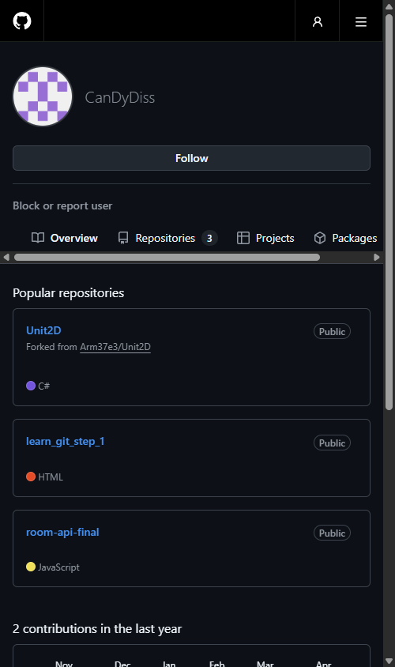
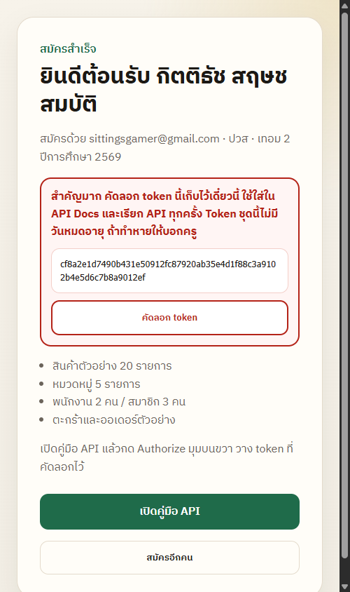
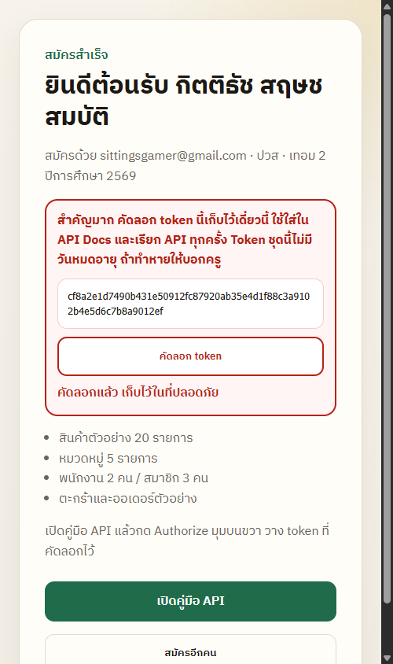

# รายงานผลการปฏิบัติการ: สัปดาห์ที่ 1
## วิชา 24-40901-2103 การพัฒนาเว็บแอพพลิเคชันขั้นสูง (Advanced Web Application Development)
**ภาคเรียนที่ 2/2569 • สาขาวิชาเทคโนโลยีสารสนเทศ วิทยาลัยอาชีวศึกษาอุดรธานี**

---

### 👨‍🎓 ข้อมูลนักศึกษาผู้จัดทำ
- **ชื่อ-นามสกุล:** นายกิตติธัช สฤษชสมบัติ
- **รหัสนักศึกษา:** 69409010901
- **ระดับการศึกษา:** ทล.บ. / ปวส. เทคโนโลยีสารสนเทศ
- **อาจารย์ผู้สอน:** นายภาณุเมศ ชุมภูนท์ (ครูโอ้) • oh@udvc.ac.th

---

### 🎯 วัตถุประสงค์การเรียนรู้ (Week 1 Objectives)
1. ทำความเข้าใจสถาปัตยกรรม Modern Web Ecosystem 2026, Single Page Application (SPA), React, Vite และ TypeScript
2. ติดตั้งและจัดเตรียมสภาพแวดล้อมเครื่องมือพัฒนาซอฟต์แวร์ (Node.js LTS, npm, Git, VS Code)
3. สมัครบัญชีใช้งาน GitHub และสร้าง Repository สำหรับส่งงาน
4. ลงทะเบียนรับสิทธิ์เข้าถึงระบบ Multi-Tenant API ของครูโอ้ (`api.kruoh.dev`) พร้อมเก็บรักษา Permanent API Token 64 หลัก
5. เขียนและทดสอบสคริปต์ JavaScript ในการเชื่อมโยงข้อมูลกับ Backend API

---

### 📂 โครงสร้างโฟลเดอร์ไฟล์ (Project Structure)
```text
สัปดาห์ที่ 01_ปฐมนิเทศและเตรียมสภาพแวดล้อม/
├── week1-evidence/
│   ├── 01-github-account.png          # ภาพหลักฐานหน้าโปรไฟล์ GitHub
│   ├── 02-api-register-success.png    # ภาพหลักฐานหน้ายืนยันการสมัคร API สำเร็จ
│   └── 03-api-token.png               # ภาพหลักฐานหน้าแสดง API Token ถาวร
├── check-env.js                       # สคริปต์ตรวจความพร้อม Node.js และระบบ
├── test-kruoh-api.js                  # สคริปต์ทดสอบเชื่อมต่อ API ดึงรายการสินค้า
├── package.json                       # ไฟล์คอนฟิก Node.js โปรเจกต์
├── .gitignore                         # ไฟล์ละเว้นไฟล์ที่ไม่จำเป็นในการขึ้น Git
├── README.md                          # รายงานสรุปผลการปฏิบัติการสัปดาห์ที่ 1
└── วิธีส่งงาน_สัปดาห์ที่1.md          # คู่มือขั้นตอนการนำขึ้น GitHub และส่งงานบน LMS
```

---

### 🖼️ ภาพหลักฐานการปฏิบัติการ (Lab Evidences)

#### 1. ภาพหลักฐานบัญชี GitHub (`week1-evidence/01-github-account.png`)
แสดงหน้าโปรไฟล์ GitHub ยืนยันตัวตนเจ้าของบัญชีสำหรับส่งผลงาน


#### 2. ภาพหลักฐานการสมัคร API สำเร็จ (`week1-evidence/02-api-register-success.png`)
แสดงหน้าจอการลงทะเบียนสร้างห้องข้อมูล Tenant สำเร็จบน `api.kruoh.dev`


#### 3. ภาพหลักฐาน API Token ถาวร (`week1-evidence/03-api-token.png`)
แสดงรหัส API Token ถาวรความยาว 64 ตัวอักษร สำหรับใช้ยืนยันสิทธิ์ในการดึงและจัดการข้อมูล


---

### 💻 ผลการรันสคริปต์ทดสอบ (Execution Results)

#### คำสั่งตรวจสอบสภาพแวดล้อม:
```bash
node check-env.js
```
**ผลลัพธ์:**
```text
==================================================
🚀 ยินดีต้อนรับสู่วิชาเว็บแอพพลิเคชันขั้นสูง (24-40901-2103)
==================================================
Node.js Version : v22.16.0
Platform        : win32 x64
👨‍🎓 นักศึกษา: กิตติธัช สฤษชสมบัติ (69409010901)
📚 รายวิชา  : 24-40901-2103 การพัฒนาเว็บแอพพลิเคชันขั้นสูง
🎯 สถานะความพร้อม: พร้อมสำหรับการเรียนรู้ 100% ✅
==================================================
```

#### คำสั่งทดสอบการเชื่อมต่อ API ครูโอ้:
```bash
node test-kruoh-api.js
```

---

### 📊 สรุปการประเมินตามเกณฑ์ (Rubric Self-Checklist)
| เกณฑ์การประเมิน (Rubrics) | คะแนนเต็ม | สถานะการส่งมอบ |
| :--- | :---: | :---: |
| 1. ไฟล์รูป `.png/.jpg` ของบัญชี GitHub (เห็นชัดว่าเป็นของตนเอง) | 3 คะแนน | ✅ ครบถ้วน (`01-github-account.png`) |
| 2. ไฟล์รูป `.png/.jpg` ของหน้าสมัคร API ที่ `api.kruoh.dev` สำเร็จ | 4 คะแนน | ✅ ครบถ้วน (`02-api-register-success.png`) |
| 3. ไฟล์รูป `.png/.jpg` ของ API Token ที่ได้หลังสมัคร | 3 คะแนน | ✅ ครบถ้วน (`03-api-token.png`) |
| **รวมคะแนนที่คาดว่าจะได้รับ** | **10 / 10** | **พร้อมส่ง 100%** |
